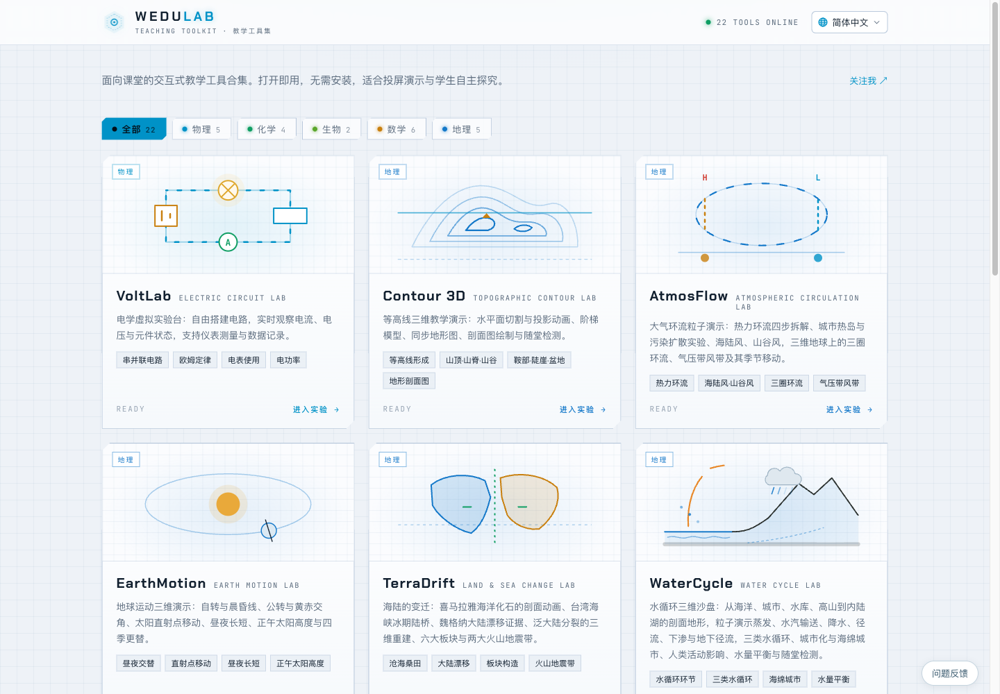
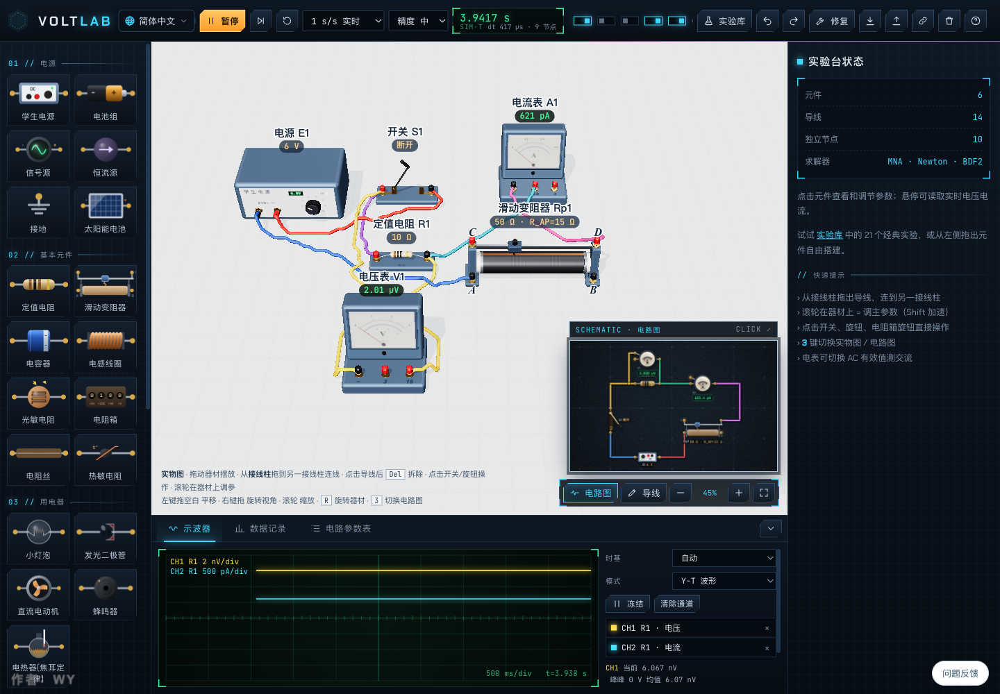
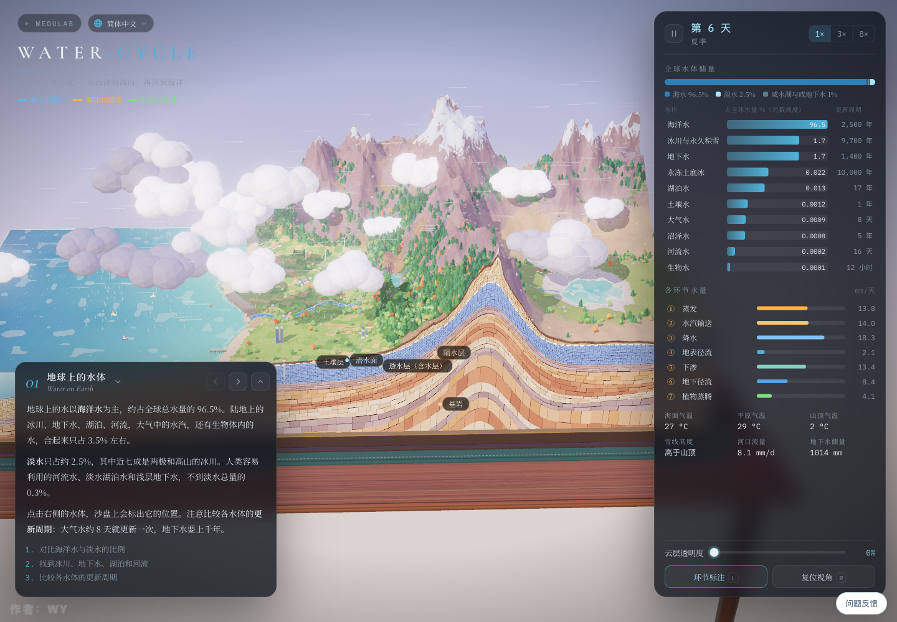
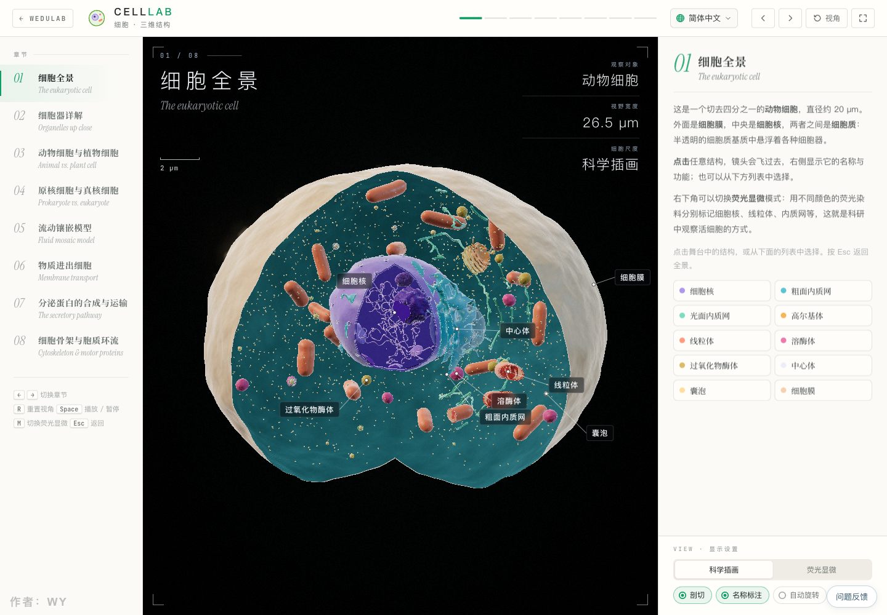
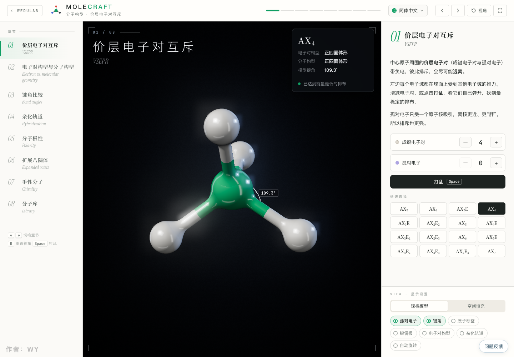
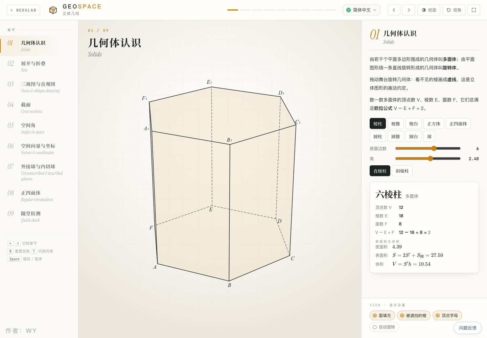

# WeduLab · 交互式教学工具集

**把课本中的概念变成可以观察、操作和探索的实验。**

WeduLab 是一个面向课堂的交互式教学网站，包含物理、化学、生物、数学和地理五个学科的 **22 个实验工具**。在浏览器中打开即可使用，适合教师投屏演示，也适合学生自主探究。

从搭建电路、观察细胞，到旋转空间几何体、追踪水循环，WeduLab 通过三维场景、动画、参数调节和实时数据，把抽象知识呈现在眼前。

**[打开 WeduLab →](https://wedulab.com/?lang=zh-CN)**



## 可以用它做什么？

- **课堂演示**：按照章节讲解，结合模型、标注和动画展示知识点。
- **动手探索**：改变参数、拖动视角、选择模型，观察结果如何变化。
- **实验观察**：搭建电路、读取仪表，或在微观与宏观场景中理解过程。
- **自主学习**：配合章节说明和部分实验中的随堂检测，逐步理解概念。

网站支持简体中文、繁体中文、英语、日语、韩语和土耳其语。

## 实验画面

以下图片均来自项目在浏览器中的实际运行画面，点击图片可查看大图。

### 物理 · VoltLab 电学实验台

自由搭建电路，连接电源、开关、电阻和仪表；在实物图与电路图之间切换，观察电流、电压以及示波器波形。实验库提供常见电学实验，支持测量和数据记录。

[](docs/screenshots/volt.png)

### 地理 · WaterCycle 水循环三维沙盘

在海洋、高山、河流与地下含水层组成的剖面沙盘中，观察蒸发、水汽输送、降水、地表径流、下渗和地下径流，理解水体储量与水循环过程。

[](docs/screenshots/water.png)

### 生物 · CellLab 细胞三维结构

从切开的细胞模型观察细胞器，点击结构查看名称和功能；比较动植物细胞、原核与真核细胞，探索细胞膜、跨膜运输和分泌蛋白的合成与运输。

[](docs/screenshots/cell.png)

### 化学 · MoleCraft 分子构型

调整成键电子对与孤对电子，观察分子构型和键角变化；结合球棍模型理解价层电子对互斥、杂化轨道、分子极性和手性。

[](docs/screenshots/vsepr.png)

### 数学 · GeoSpace 立体几何

旋转几何体，查看顶点、棱与面；通过展开折叠、三视图、截面、空间角和空间向量，将纸面上的立体几何变成可操作的空间模型。

[](docs/screenshots/geo.png)

## 全部 22 个工具

| 学科 | 数量 | 实验主题 |
| --- | --- | --- |
| 物理 | 5 | 电学实验台、运动与力、光学、振动与波、电场与磁场 |
| 化学 | 4 | 反应机理、分子构型、原子轨道、化学反应微观模拟 |
| 生物 | 2 | 细胞三维结构、显微镜实验台 |
| 数学 | 6 | 立体几何、圆锥曲线、函数、尺规作图、勾股定理、数学奇境 |
| 地理 | 5 | 等高线、大气环流、地球运动、海陆变迁、水循环 |

## 本地运行

需要 **Node.js 24 或更新版本**。项目已包含前端运行库和字体，可以直接启动。

```sh
git clone https://github.com/DuanHangyu/wedulab-recovered.git
cd wedulab-recovered/project
npm run dev
```

打开 **http://127.0.0.1:4174/?lang=zh-CN**。

构建并运行生产版本：

```sh
# 在 project/ 目录中执行
npm run build
npm start
```

## 项目结构

| 目录 | 内容 |
| --- | --- |
| [`project/src/home/`](project/src/home/) | 首页与实验目录 |
| [`project/src/labs/`](project/src/labs/) | 各实验的场景、模型与交互 |
| [`project/src/i18n/`](project/src/i18n/) | 多语言词典 |
| [`project/public/`](project/public/) | 样式、字体、纹理与地图资源 |
| [`project/server/`](project/server/) | 网站服务、反馈与管理统计 |
| [`docs/screenshots/`](docs/screenshots/) | README 中的实际运行截图 |

更多运行配置与维护说明见 [项目文档](project/README.md)。可下载版本见 [Releases](https://github.com/DuanHangyu/wedulab-recovered/releases)。

## 作者与许可

网站作者：**WY** · [X / @akokoi1](https://x.com/akokoi1)

项目与所含第三方库、字体及数据的原有许可仍适用；本仓库未额外授予新的开源许可。
